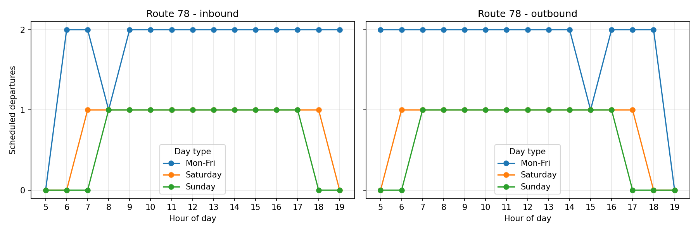

# Arriva bus timetable analysis (Bus Open Data Service)

A Python pipeline that reads Arriva's published timetable files and turns them into one clean table with a row per scheduled bus journey, then looks at how service frequency varies by route, direction, day type and hour.



## What it does

- Parses **384 TransXChange XML files** into **11,465 scheduled journeys across 97 routes** (61 linear, 36 circular).
- Gives each journey a route, direction, departure time and operating days.
- Builds hourly frequency profiles by route, direction and day type (Mon-Fri, Saturday, Sunday).
- Validated against Arriva's published timetable: Route 78 on a weekday comes out at **27 outbound and 27 inbound** journeys, matching the published times. This check is a test (`tests/test_pipeline.py`).

## What it does not do

The data is **scheduled service**, not ridership. It cannot show passenger numbers, delays or cancellations, so this is an analysis of service supply. A timetable simulator that tests proposed changes against demand is the planned next stage and would need a demand source.

## Problems found while checking the output

My first count for Route 78 was wrong. Tracing it led to three fixes, now built into the code:

1. The route name in the **filename** (`K78`) differs from the route passengers see (`78`). The real name is `<LineName>` inside the file.
2. **Direction** comes from each journey's `JourneyPattern`, not the filename.
3. **Operating days** usually sit on the `Service`, not on each journey, and some files use shorthand such as `MondayToFriday`.

## Repository layout

```
bods_pipeline.py        the reusable code (extract, clean, analyse)
notebooks/bods_analysis.ipynb   walkthrough with results (outputs saved)
tests/test_pipeline.py  tests, including the Route 78 check
data/sample/            three Route 78 files so the tests and notebook run
data/raw/               put the full download here (not committed)
```

## Run it

```bash
pip install -r requirements.txt
python -m pytest                      # runs against data/sample
python bods_pipeline.py data/sample   # small sample
python bods_pipeline.py               # full data in data/raw, route 78
python bods_pipeline.py data/raw --route 86A
```

Outputs are written to `output/`: `master_journeys_clean.csv` and `route_<ROUTE>_hourly.csv/.png`.

## Getting the full data

Download the Arriva timetable dataset from the [Bus Open Data Service](https://data.bus-data.dft.gov.uk/), extract the `.xml` files into `data/raw/`, and run the pipeline. The full download is not committed to keep the repository small.

## Data licence

Contains public sector information licensed under the Open Government Licence v3.0. Source: Bus Open Data Service, Department for Transport.
